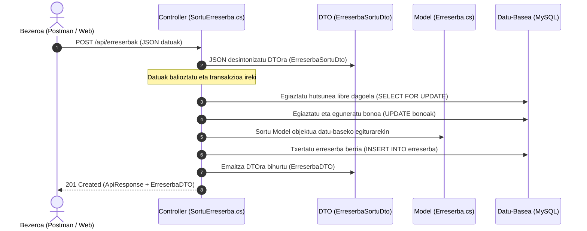

# DTO, Model eta Controller Arkitektura-Gida

Gida honek REST API baten barruan **DTO** (Data Transfer Object), **Model** (Domeinu-Eredua) eta **Controller** (Kontroladorea) osagaien arteko desberdintasunak, eginkizunak eta elkarrekintza azaltzen ditu, Ordiziako Kiroldegiaren proiektuko adibide errealak oinarri hartuta.

---

## 1. Zer da DTO bat? (Data Transfer Object)

**DTO** (Datuak Garraiatzeko Objektua) sistemaren geruzen artean (adibidez, bezeroaren/Postman-en eta API zerbitzariaren artean) datuak bidaltzeko eta jasotzeko diseinatutako objektu arina da.

### DTOen Ezaugarri Nagusiak:
- **POCO hutsak dira (Plain Old CLR Objects):** Propietateak (`get; set;`) soilik dituzte, inolako negozio-logikarik edo datu-baseko deirik gabe.
- **Datu-kontratua definitzen dute:** APIak kanpora zer erakusten duen (irteerako DTOak) eta bezeroari zer eskatzen dion (sarrerako DTOak) zehazten dute.
- **Segurtasuna eta Datu-Kapsulazioa:**
  - Barneko datu-baseko egitura babesten dute.
  - **Overposting / Mass Assignment** arriskuak saihesten dituzte: bezeroak ezin ditu zuzenean aldatu aldatu behar ez diren eremuak (adibidez, IDak, sorrera-datak edo `ezabatua` markak).
  - Datu sentikorrak ez dituzte kanpora zabaltzen.
- **Datuen optimizazioa:** Bezeroak pantailan behar dituen datuak soilik bidaltzen dira sarean zehar, gehiegizko informazioa (overhead) ekidinez.

---

## 2. Hiru Osagaien Alderaketa-Taula

| Irizpidea | Controllers (Kontroladoreak) | Models (Domeinu-Ereduak) | DTO (Data Transfer Objects) |
| :--- | :--- | :--- | :--- |
| **Eginkizun Nagusia** | HTTP eskaerak jaso, negozio-logika eta transakzioak kudeatu, eta erantzuna prestatu. | Datu-baseko taularen egitura eta datuak C#-n errepresentatu (1:1 mapaketa). | Sare bidez (JSON) bezeroaren eta APIaren artean datuak seguru garraiatu. |
| **Kokapena Arkitekturan** | Sarrera- eta orkestrazio-geruza (`Controllers/`). | Barneko datu- eta domeinu-geruza (`Models/`). | Kanpoko komunikazio- eta kontratu-geruza (`DTO/`). |
| **Datu-Basearekiko Lotura** | Zuzenean exekutatzen ditu SQL komandoak eta transakzioak (`MySqlCommand`, `FOR UPDATE`). | Datu-baseko taula fisikoaren ispilu zuzena da (zutabeak, gako nagusiak, motak). | Ez du datu-basearen berririk; ez du SQL kontsultarik edo konexiorik ezagutzen. |
| **Logika eta Metodoak** | Bai: balioztapenak, transakzio-kudeaketa, errore-kontrola eta metodo laguntzaileak. | Ez: propietateak soilik (edo domeinu-logika oso sinplea). | Ez: propietate hutsak (`get; set;`) eta datuen balioztatze-oharrak (`[Required]`). |
| **Fitxategien Edukia** | Endpoint bakoitzeko metodo asinkronoak (`Task<IActionResult>`). | Taulako eremu bakoitzeko propietateak (`Id`, `Izena`, `SortzeData`...). | Eskaera edo erantzun bakoitzerako beharrezko diren propietateak soilik. |
| **Kiroldegiko Adibidea** | `Controllers/Erreserbak/SortuErreserba.cs` | `Models/Erreserba.cs` | `DTO/ErreserbaDto.cs` (`ErreserbaSortuDto`) |

---

## 3. Komunikazio-Fluxua: Nola Lan Egiten Dute Elkarrekin?

Hona hemen bezero batek erreserba berri bat egitean osagai bakoitzak jokatzen duen papera:

---

## 4. Zergatik EZ dugu Model zuzenean erabiltzen sarreran eta irteeran?

Hasieran pentsa liteke errazagoa dela `Models/Erreserba.cs` zuzenean jasotzea kontroladorean eta zuzenean itzultzea, baina horrek arazo larriak sortzen ditu:

1. **Beharrezkoak ez diren eremuak eskatzea:**
   - `Models/Erreserba.cs` klaseak `id` dauka. Baina erreserba berria sortzean, `id` MySQL-k kalkulatzen du automatikoki (`AUTO_INCREMENT`). Bezeroak ez du IDrik bidali behar.
   - `Models/Erreserba.cs` klaseak `sortze_data` eta `ezabatua` dauzka. Bezeroak ezin ditu balio hauek manipulatu; zerbitzariak automatikoki ezartzen ditu.
2. **Kalkulatutako edo elkartutako datuak falta izatea:**
   - Bezeroak erreserben zerrenda eskatzen duenean (`GET /api/erreserbak`), ez ditu ID zenbaki hutsak nahi; pistaren izena (`Tenisa 1`) eta erreserba egin duen bazkidearen izen-abizenak ikusi nahi ditu.
   - `Models/Erreserba.cs` klaseak `pista_id` eta `erabiltzaile_emaila` bakarrik ditu.
   - `DTO/ErreserbaDto.cs` klaseko `ErreserbaDTO`ak, ordea, `PistaIzena`, `ErabiltzaileIzena` eta `ErabiltzaileAbizena` eremuak gehitzen ditu kontsulta aberasteko.
3. **Akoplamendua eta Egonkortasuna:**
   - Datu-baseko zutabe baten izena aldatzen bada, `Model` aldatu beharko da, baina `DTO`a berdin mantendu daiteke. Horrela, kanpoko bezeroen aplikazioak ez dira apurtzen barne-egitura aldatzeagatik.

---

## 5. Proiektuko Egitura Erreala

- [Controllers/](file:///c:/Dev/GoierriEskola/2_maila/0486-Datu-atzipena/1_ebaluaketa/6-transakzioak/ariketak/10_jarraipena/API_kiroldegia_db/API_kiroldegia_db/Controllers/): Negozio-logika eta HTTP endpoint-ak banatuta dauden lekuak.
  - [Controllers/Pistak/](file:///c:/Dev/GoierriEskola/2_maila/0486-Datu-atzipena/1_ebaluaketa/6-transakzioak/ariketak/10_jarraipena/API_kiroldegia_db/API_kiroldegia_db/Controllers/Pistak/)
  - [Controllers/Bazkideak/](file:///c:/Dev/GoierriEskola/2_maila/0486-Datu-atzipena/1_ebaluaketa/6-transakzioak/ariketak/10_jarraipena/API_kiroldegia_db/API_kiroldegia_db/Controllers/Bazkideak/)
  - [Controllers/Bonoak/](file:///c:/Dev/GoierriEskola/2_maila/0486-Datu-atzipena/1_ebaluaketa/6-transakzioak/ariketak/10_jarraipena/API_kiroldegia_db/API_kiroldegia_db/Controllers/Bonoak/)
  - [Controllers/Erreserbak/](file:///c:/Dev/GoierriEskola/2_maila/0486-Datu-atzipena/1_ebaluaketa/6-transakzioak/ariketak/10_jarraipena/API_kiroldegia_db/API_kiroldegia_db/Controllers/Erreserbak/)
- [Models/](file:///c:/Dev/GoierriEskola/2_maila/0486-Datu-atzipena/1_ebaluaketa/6-transakzioak/ariketak/10_jarraipena/API_kiroldegia_db/API_kiroldegia_db/Models/): MySQL taulak zuzenean islatzen dituzten 4 klaseak.
  - [Pista.cs](file:///c:/Dev/GoierriEskola/2_maila/0486-Datu-atzipena/1_ebaluaketa/6-transakzioak/ariketak/10_jarraipena/API_kiroldegia_db/API_kiroldegia_db/Models/Pista.cs) (`pista` taula)
  - [Bazkidea.cs](file:///c:/Dev/GoierriEskola/2_maila/0486-Datu-atzipena/1_ebaluaketa/6-transakzioak/ariketak/10_jarraipena/API_kiroldegia_db/API_kiroldegia_db/Models/Bazkidea.cs) (`bazkidea` taula)
  - [Bonoa.cs](file:///c:/Dev/GoierriEskola/2_maila/0486-Datu-atzipena/1_ebaluaketa/6-transakzioak/ariketak/10_jarraipena/API_kiroldegia_db/API_kiroldegia_db/Models/Bonoa.cs) (`bonoak` taula)
  - [Erreserba.cs](file:///c:/Dev/GoierriEskola/2_maila/0486-Datu-atzipena/1_ebaluaketa/6-transakzioak/ariketak/10_jarraipena/API_kiroldegia_db/API_kiroldegia_db/Models/Erreserba.cs) (`erreserba` taula)
- [DTO/](file:///c:/Dev/GoierriEskola/2_maila/0486-Datu-atzipena/1_ebaluaketa/6-transakzioak/ariketak/10_jarraipena/API_kiroldegia_db/API_kiroldegia_db/DTO/): Entitate bakoitzeko komunikazio-objektuak bateratuta dituzten 4 fitxategiak.
  - [PistaDto.cs](file:///c:/Dev/GoierriEskola/2_maila/0486-Datu-atzipena/1_ebaluaketa/6-transakzioak/ariketak/10_jarraipena/API_kiroldegia_db/API_kiroldegia_db/DTO/PistaDto.cs) (`PistaDTO`, `PistaSortuDTO`)
  - [BazkideaDto.cs](file:///c:/Dev/GoierriEskola/2_maila/0486-Datu-atzipena/1_ebaluaketa/6-transakzioak/ariketak/10_jarraipena/API_kiroldegia_db/API_kiroldegia_db/DTO/BazkideaDto.cs) (`BazkideaDTO`, `BazkideaSortuDTO`)
  - [BonoDto.cs](file:///c:/Dev/GoierriEskola/2_maila/0486-Datu-atzipena/1_ebaluaketa/6-transakzioak/ariketak/10_jarraipena/API_kiroldegia_db/API_kiroldegia_db/DTO/BonoDto.cs) (`BonoDTO`, `BonoKargatuDTO`)
  - [ErreserbaDto.cs](file:///c:/Dev/GoierriEskola/2_maila/0486-Datu-atzipena/1_ebaluaketa/6-transakzioak/ariketak/10_jarraipena/API_kiroldegia_db/API_kiroldegia_db/DTO/ErreserbaDto.cs) (`ErreserbaDTO`, `ErreserbaSortuDto`)
